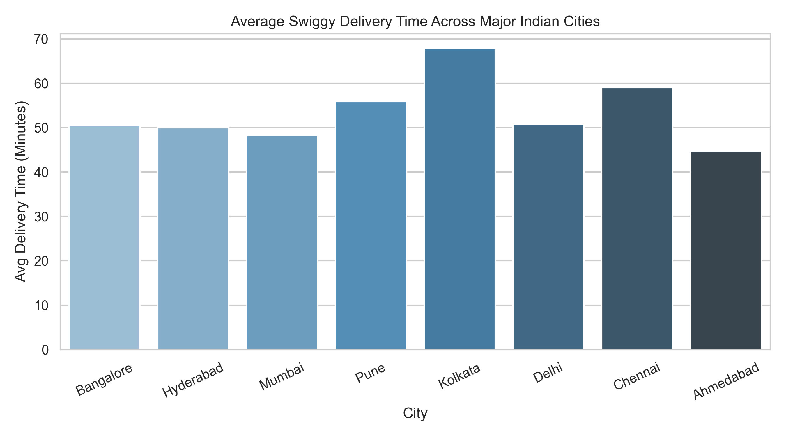
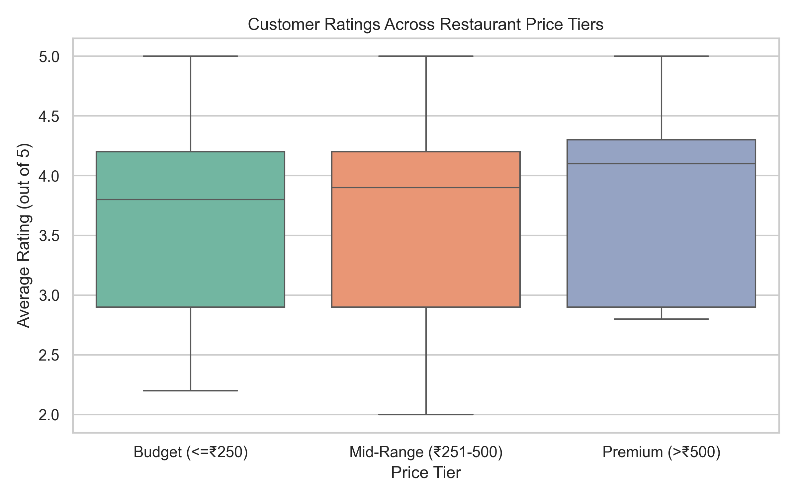
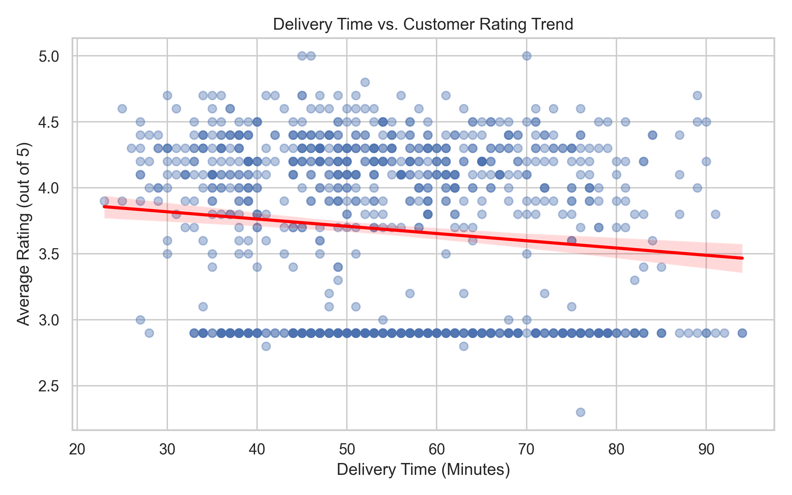

# Swiggy-Delivery-Analysis
# Swiggy Restaurant Delivery & Pricing Analysis

## Project Overview
An Exploratory Data Analysis (EDA) of **8,600+ real-world Swiggy restaurant listings** across major Indian cities using **Python (`Pandas`, `NumPy`, `Seaborn`, `Matplotlib`)**. This project investigates how city location, restaurant pricing tiers, and delivery turnaround times influence customer ratings.

## Tools & Libraries Used
- **Python 3**
- **Pandas & NumPy:** Data cleaning, deduplication, type conversion, and price-tier feature engineering
- **Seaborn & Matplotlib:** Statistical data visualization (Bar plots, Box plots, Regression plots)

## Key Analytical Findings
- **Dataset Scale:** Cleaned and standardized **8,680+ restaurant records** across major Indian cities.
- **City Delivery Performance:** Analyzed average delivery turnaround times across top cities, highlighting regional speed variations.
- **Pricing vs. Ratings:** Segmented restaurants into *Budget (≤₹250)*, *Mid-Range (₹251–500)*, and *Premium (>₹500)* tiers, demonstrating how budget restaurants maintain competitive customer ratings alongside premium outlets.
- **Delivery Speed Impact:** Evaluated the correlation between delivery duration and average customer ratings using regression analysis.

## Visual Insights

### 1. Average Delivery Time Across Major Cities


### 2. Customer Ratings Across Price Tiers


### 3. Delivery Time vs. Customer Rating Trend


## How to Run Locally
1. Clone this repository:
   ```bash
   git clone [https://github.com/](https://github.com/)dhanushshenoy746/Swiggy-Restaurant-Delivery-Analysis.git
   cd Swiggy-Restaurant-Delivery-Analysis
2.Install required libraries:
```bash
    pip install pandas numpy seaborn matplotlib
```
3.Run the analysis script:
  ```bash
  python swiggy_analysis.py
```
